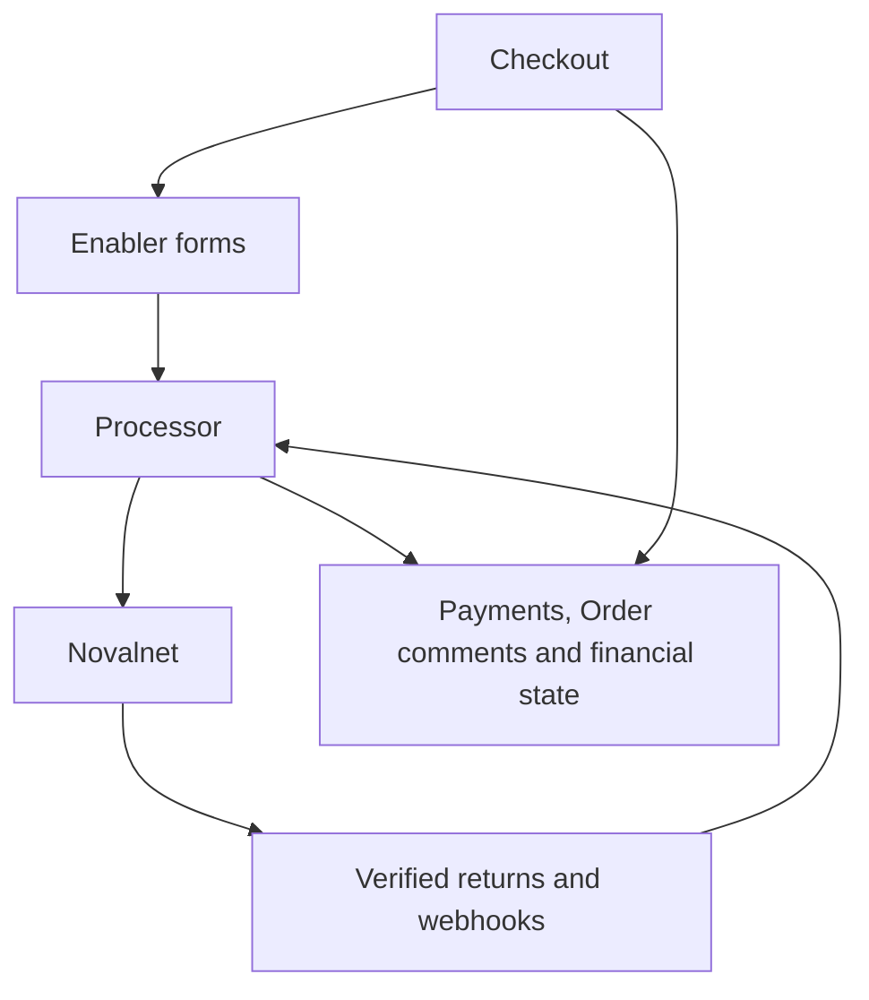

# Novalnet Payment Connector for commercetools

This connector integrates Novalnet with commercetools Checkout. Checkout owns Cart-to-Order creation. The connector updates Payment transactions, comments and the agreed financial Order paymentState; it never changes fulfillment orderState.

Baseline: commercetools-testing-main(20261022-073245).zip. This revision restores the original two-application deployment and original configuration keys. It is locally tested, not certified. See [comparison](COMPARISON.md), [changes and removals](CHANGES.md), [QA](QA_REPORT.md), [mapping](STATUS_MAPPING.md) and [acceptance tests](TEST_PLAN.md).

## Applications

| Application | Type | Responsibility |
| --- | --- | --- |
| enabler | assets | Payment-specific forms, Novalnet browser libraries and shopper errors. |
| processor | service | Direct/redirect payments, verified returns/webhooks, Payment Intents and commercetools synchronization. |



The initial PAYMENT webhook synchronizes the initial direct/redirect attempt, including communication failure. Capture, cancellation, refund and credit remain separate events. Payment Intents apply their direct API response themselves; their shop_invoked=1 follow-up callbacks skip ordinary webhook handling.

## Payment methods

| Method | Novalnet code | Flow |
| --- | --- | --- |
| Credit/Debit Cards | CREDITCARD | Direct / 3DS redirect |
| Direct Debit SEPA | DIRECT_DEBIT_SEPA | Direct |
| Direct Debit ACH | DIRECT_DEBIT_ACH | Direct |
| Invoice | INVOICE | Direct |
| Prepayment | PREPAYMENT | Direct |
| Invoice with payment guarantee | GUARANTEED_INVOICE | Direct |
| Direct Debit SEPA with payment guarantee | GUARANTEED_DIRECT_DEBIT_SEPA | Direct |
| Multibanco | MULTIBANCO | Direct |
| iDEAL \| Wero | IDEAL | Redirect |
| PayPal | PAYPAL | Redirect |
| Online bank transfer | ONLINE_BANK_TRANSFER | Redirect |
| Przelewy24 | PRZELEWY24 | Redirect |
| eps | EPS | Redirect |
| Bancontact | BANCONTACT | Redirect |
| Alipay | ALIPAY | Redirect |
| WeChat Pay | WECHATPAY | Redirect |
| Trustly | TRUSTLY | Redirect |
| TWINT | TWINT | Redirect |
| PostFinance E-Finance | POSTFINANCE | Redirect |
| PostFinance Card | POSTFINANCE_CARD | Redirect |
| MB WAY | MBWAY | Redirect |
| Blik | BLIK | Redirect |
| Pix | PIX | Redirect |
| Boleto | BOLETO | Redirect |
| Bizum | BIZUM | Redirect |
| BANCOMAT Pay | BANCOMATPAY | Redirect |
| KakaoPay | KAKAOPAY | Redirect |
| Naver Pay | NAVERPAY | Redirect |

Each method keeps its own component. Localized `Payment.paymentMethodInfo.name` supplies the merchant/account payment name; the stable method identifier selects the component. That Payment name does not configure Checkout's logo, label or description. For methods treated as custom in your Checkout integration, configure its `displayInfo` explicitly; a provider's predefined EPS metadata does not imply defaults for every other identifier.


## Retained business behavior

ON_HOLD means Authorization/Success; PENDING means Authorization/Pending. Guarantee thresholds/fallback, payment/authorize actions, supported methods and Novalnet Utility CDN/runtime behavior are retained. SEPA due dates are 3–14 days (default 3), Prepayment 7–28 (default 14), Invoice greater than 7 (default 14). KakaoPay and Pix remain the approved display names.

Normal cash refunds and chargebacks retain the merchant policy for Order paymentState. Pre-credit refunds are detected from response evidence, not a payment-type filter: a partial reduction saves remaining balance and refund comments immediately; DEACTIVATED without a new refund TID completes cancellation using refund wording. CREDIT completes the net obligation after accepted reductions. Single-Payment Orders use this connector's financial mapping; multiple-Payment aggregate state belongs to Checkout/the merchant.

Intents support full capture, cancellation, normal partial/full refunds and the existing pre-credit refund path. Repeated portal partial captures are not supported. No independent B2B guarantee toggle is implemented.

## Build and deployment

Use Node 22 or 24 (local checks used Node 24.19.0). Run separately in processor and enabler:

```bash
npm ci
npm run build
npm test -- --runInBand
```

In processor also run npm run lint. The enabler build typechecks source and rebuilds both public ES/UMD bundles; deploy matching source and assets together. Local tests use mocks and need no real credentials. Docker Compose is a local development helper.

Use the existing connect.yaml configuration fields: project credentials, regional API/auth/Session/JWT URLs, Novalnet credentials and method settings. No new environment field is required. The Checkout regional origin derives from the existing CTP_API_URL. Novalnet's public gateway origin remains the original fixed endpoint. Keep deployment credentials in secured fields. Existing lifecycle hooks initialize compatible Custom Types and retain financial history on undeploy. Give the existing API client the permissions required by the SDK and the operations actually used, including Payments, Orders, Carts, Types, Custom Objects and registered-customer lookup; see the existing client field description. Do not introduce placeholder shop/customer data to satisfy configuration.

After deployment configure the existing webhook URL (the spelling /novalnletWebhook is preserved), integration and original merchant return destinations. Start fresh payment attempts: signed return parameters reject old unsigned return links. Configure custom method displayInfo in the Checkout payment integration for labels/descriptions/logos; a friendly recorded Payment name alone cannot create Checkout's predefined metadata.

## Error display and return contract

Direct declines and guarantee-condition failures display a plain-text accessible alert and call the existing Checkout onError callback. It closes after eight seconds. For failed/cancelled redirects, the verified return stores a 15-minute Cart-scoped notice; the enabler retrieves it with the active authenticated Checkout Session and acknowledges after display. Starting a new attempt suppresses old notices. Expired notices are not displayed and are deleted on retrieval; no scheduled cleanup service is included.

The original return destinations are preserved: success uses the merchant thank-you/Order lookup path, failure returns to checkout. The storefront must remount/resume the matching Checkout Session so the enabler can retrieve the notice. A URL message alone cannot display inside a cross-origin hosted Checkout frame. The merchant frontend is outside this repository and must be tested in deployment. No generic new returnTo routing feature is included. Financial changes require verified provider evidence, never just browser query text.

## Safe follow-up retries

A small pending-modification marker and completed results live in the existing nn-private-data record. There is no separate Intent journal, distributed-lock service, extra job or recovery endpoint. A repeated identical request with a supplied merchantReference returns its completed result; use a new reference for each genuinely new action, including equal-value partial refunds. Concurrent/uncertain operations are blocked from blindly repeating a financial Novalnet request.

An unknown provider outcome or failed local write returns received and leaves the pending marker. This simplified package has no automatic reconciliation worker. Verify the provider outcome and synchronize the existing Payment/metadata before resolving the pending operation; do not blindly delete the marker and resend. Ordinary shop_invoked callbacks do not repair that uncertain Intent. This is an explicit operational limitation, not a claim of automated recovery.

The webhook IP helper retains the existing Connect/GFE client-address convention and checks only the appended client slot for an internal immediate peer. Verify the actual deployed forwarding chain and ingress isolation. Arbitrary self-hosted proxy topologies require separate review; this package adds no trusted-proxy configuration.

The connector owner must supply marketplace creator/contact information, a stable Git tag, Connect preview/validation and deployed acceptance evidence before requesting certification. License: [MIT](LICENSE).
